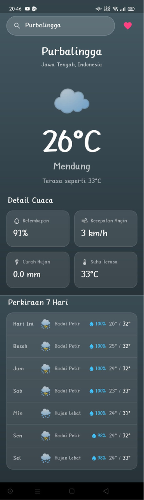
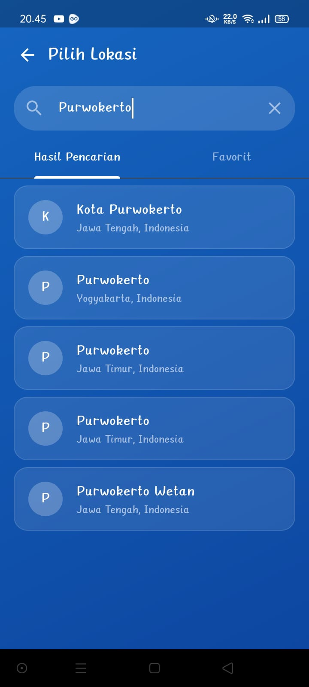
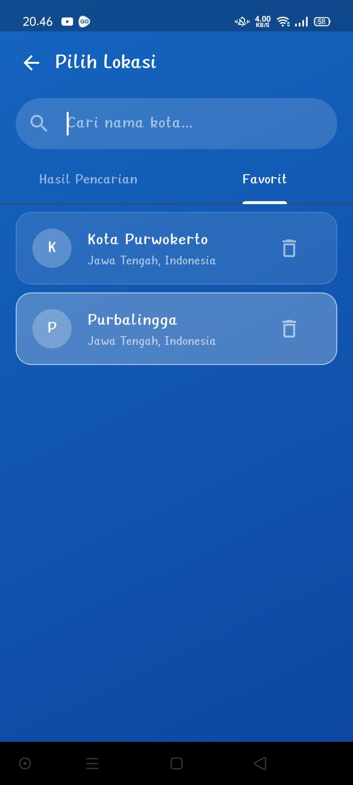

# Weather App — Responsi Flutter

Aplikasi cuaca berbasis Flutter yang menggunakan Open-Meteo API dengan arsitektur **MVVM**.

---

## Struktur Aplikasi

```
lib/
├── main.dart                    # Entry point & setup Provider
├── models/
│   ├── weather_model.dart       # Model: CurrentWeather, DailyWeather, WeatherData
│   └── location_model.dart      # Model: LocationModel (data lokasi/kota)
├── services/
│   ├── weather_service.dart     # HTTP GET ke Open-Meteo Weather API
│   ├── geocoding_service.dart   # HTTP GET ke Open-Meteo Geocoding API
│   └── storage_service.dart     # SharedPreferences (favorit & last location)
├── viewmodels/
│   ├── weather_viewmodel.dart   # ViewModel: state cuaca, favorit, lokasi
│   └── search_viewmodel.dart    # ViewModel: state pencarian kota
├── views/
│   ├── home_screen.dart         # Screen 1: Home / Weather
│   ├── search_screen.dart       # Screen 2: Search / Location
│   └── widgets/
│       ├── daily_forecast_card.dart   # Widget: baris perkiraan harian
│       └── weather_info_card.dart     # Widget: kartu info cuaca
└── utils/
    └── weather_utils.dart       # Utilitas: deskripsi & ikon cuaca, format hari
```

---

## Implementasi API

### Weather Forecast API
- **Endpoint**: `https://api.open-meteo.com/v1/forecast`
- **Parameter**:
  - `latitude`, `longitude` — koordinat lokasi yang dipilih
  - `current` — `temperature_2m`, `relative_humidity_2m`, `apparent_temperature`, `precipitation`, `weather_code`, `wind_speed_10m`
  - `daily` — `weather_code`, `temperature_2m_max`, `temperature_2m_min`, `precipitation_probability_max`
  - `timezone=auto`, `forecast_days=7`

### Geocoding API
- **Endpoint**: `https://geocoding-api.open-meteo.com/v1/search`
- **Parameter**: `name`, `count=10`, `language=id`, `format=json`

---

## Penerapan MVVM

| Layer | Peran |
|---|---|
| **Model** | `WeatherData`, `LocationModel` — representasi data murni |
| **ViewModel** | `WeatherViewModel`, `SearchViewModel` — logika bisnis & state (`ChangeNotifier`) |
| **View** | `HomeScreen`, `SearchScreen` — UI bereaksi via `Consumer<T>` |

---

## Fitur Utama

- 🌤️ **Home Screen**: Nama kota, kondisi cuaca, suhu, kelembapan, kecepatan angin, curah hujan, suhu terasa, perkiraan 7 hari
- 🔍 **Search Screen**: Pencarian kota via Geocoding API, daftar hasil, pilih lokasi
- ❤️ **Favorit**: Simpan/hapus lokasi favorit, tampil di tab Favorit
- 💾 **Local Storage**: Lokasi terakhir & daftar favorit via `SharedPreferences`
- 🔄 **Pull-to-Refresh**: Swipe bawah di Home Screen untuk muat ulang data
- ⚡ **State Handling**: Loading, error (tombol coba lagi), success, initial
- 🎨 **Material 3**: Gradient dinamis sesuai kondisi cuaca

---

## State Management

Menggunakan **Provider** (`ChangeNotifier`):
- `WeatherViewModel` — lokasi, data cuaca, loading/error, favorit
- `SearchViewModel` — query pencarian, hasil, loading/error

---

## Local Storage (SharedPreferences)

- `favorite_locations` — list JSON lokasi favorit
- `last_location` — JSON lokasi terakhir (dimuat otomatis saat buka app)

---

## Screenshot

> _Tambahkan screenshot setelah build_

| Home Screen | Search Screen | Favorit |
|---|---|---|
|  |  |  |

---

## Cara Menjalankan

```bash
cd responsi_flutter
flutter pub get
flutter run
```

---

## Dependencies

| Package | Versi | Kegunaan |
|---|---|---|
| `provider` | ^6.1.2 | State management (MVVM ViewModel) |
| `http` | ^1.2.2 | HTTP GET ke Open-Meteo API |
| `shared_preferences` | ^2.3.2 | Local storage favorit & last location |
| `intl` | ^0.19.0 | Format tanggal |
